<!-- Cards in assets/ are generated by build.py — edit the text there and re-run it. -->





<a href="https://github.com/JustinSantosh/VulGraph"></a>
<a href="https://github.com/JustinSantosh/backend"></a>
<a href="https://github.com/JustinSantosh/stocktracking"></a>
<a href="https://github.com/JustinSantosh/ai-resume-analyzer"></a>

<a href="https://github.com/JustinSantosh/fastapiticketplatform"></a>
<a href="https://github.com/JustinSantosh/personalised-recommendation-engine"></a>
<a href="https://github.com/JustinSantosh/Retail-Demand-Forecasting-System"></a>

<picture>
  <source media="(prefers-color-scheme: dark)" srcset="https://raw.githubusercontent.com/JustinSantosh/JustinSantosh/output/snake-dark.svg" />
  
</picture>


<!-- Fill in your links and uncomment:

-->

